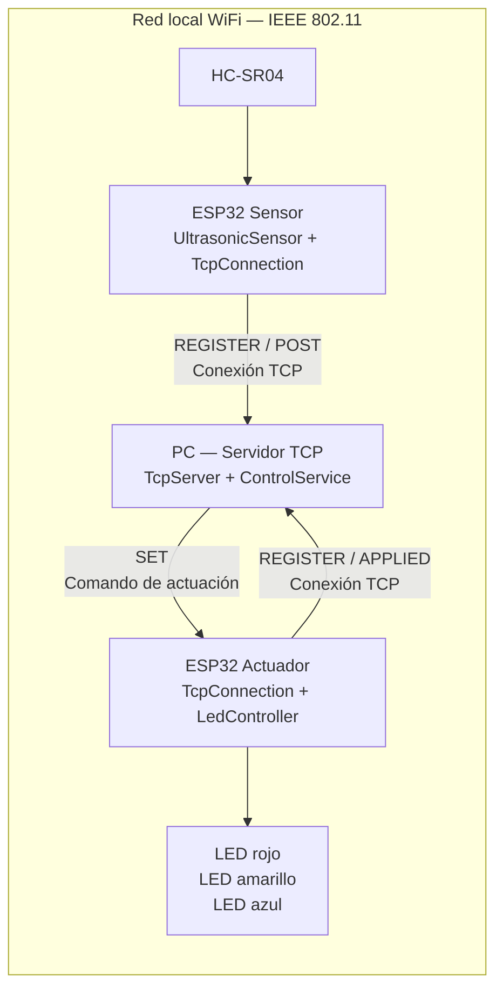
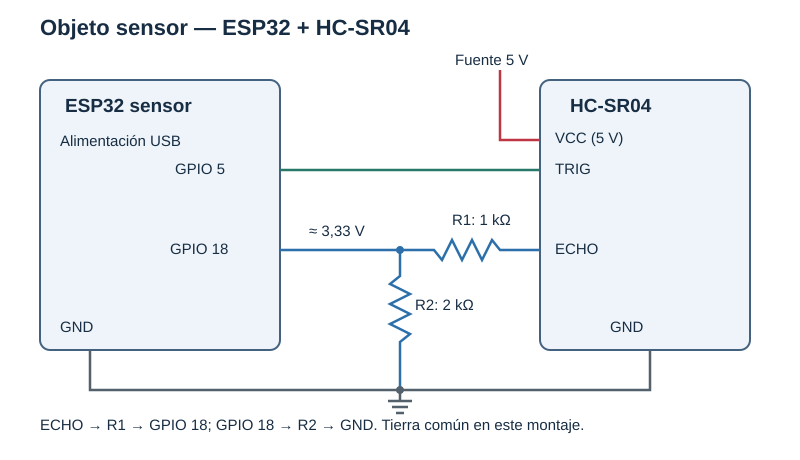
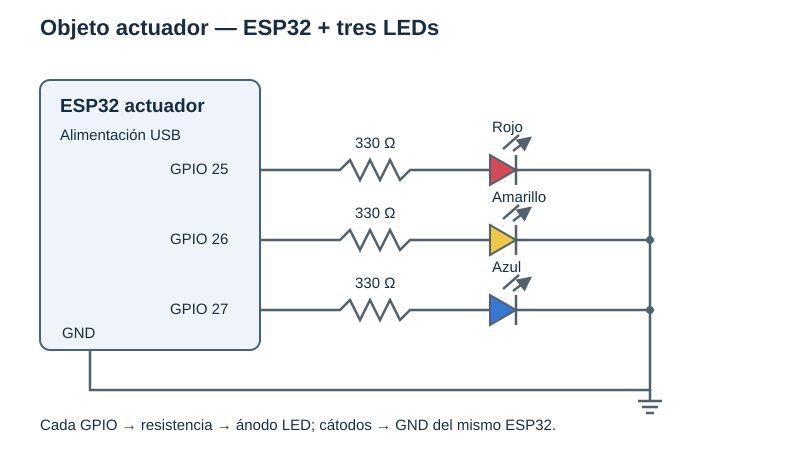
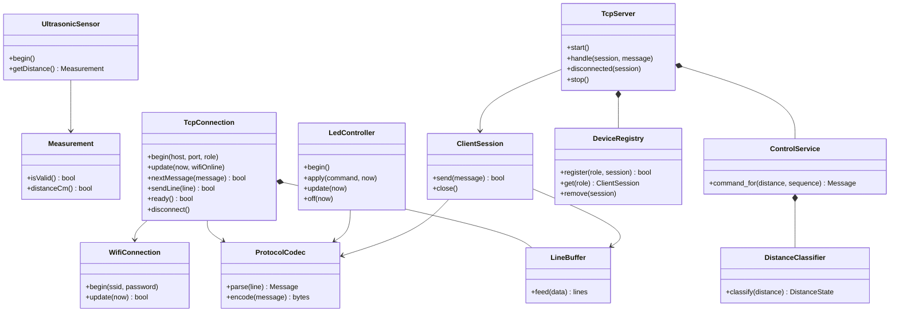
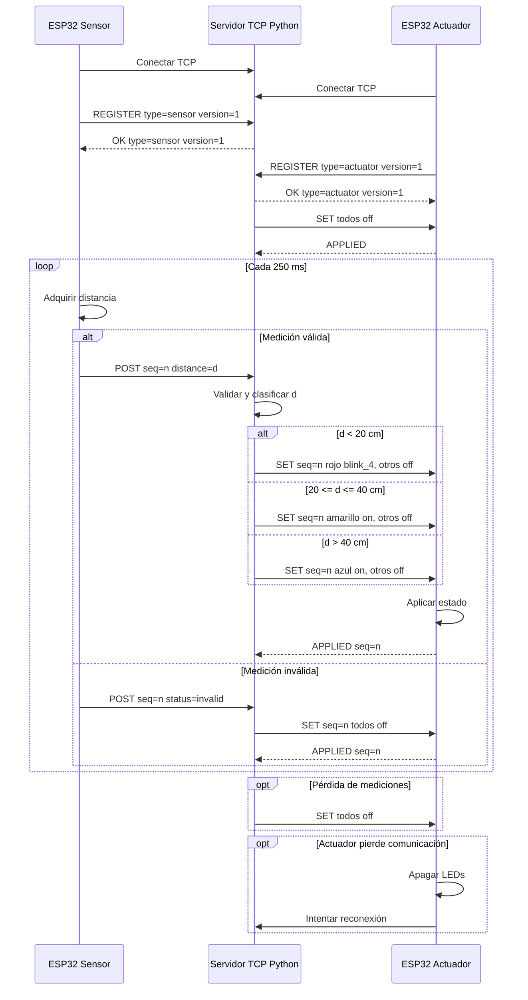

# Práctica 2 — Integración de Objetos Inteligentes con TCP/IP

**Asignatura:** Internet de las Cosas (SIS-234)  
**Carrera:** Ingeniería de Sistemas  
**Universidad:** Universidad Católica Boliviana  

**Integrantes:**
- Mateo Rojas Campos
- Lucia Escobar Galaburda

**Fecha límite de la consigna:** 13 de octubre de 2026  
**Actualización técnica y evidencias:** 19 de noviembre de 2026  
Los resultados de noviembre son posteriores al plazo original; no acreditan el estado del repositorio a la fecha de entrega.

---

# 1. Requerimientos Funcionales y No Funcionales

## 1.1 Descripción general

El proyecto consiste en el desarrollo de un sistema distribuido de objetos inteligentes que se comunican mediante sockets TCP sobre una red WiFi basada en IEEE 802.11.

El sistema está compuesto por tres componentes principales:

1. **Objeto inteligente sensor:** dispositivo ESP32 conectado a un sensor ultrasónico HC-SR04, encargado de medir la distancia existente entre el sensor y un objeto y transmitir dicha información al servidor.

2. **Servidor TCP:** aplicación desarrollada en Python y ejecutada en una computadora. Es responsable de recibir las mediciones enviadas por el objeto sensor, validar la información, clasificar la distancia según los rangos establecidos y generar los comandos de actuación correspondientes.

3. **Objeto inteligente actuador:** dispositivo ESP32 conectado a tres LEDs de color rojo, amarillo y azul. Recibe desde el servidor los comandos de actuación y modifica el estado de los LEDs.

Los dos objetos inteligentes funcionan como clientes TCP y establecen conexiones independientes con el servidor.

Esta arquitectura permite separar claramente las responsabilidades de adquisición de datos, procesamiento y actuación.

---

## 1.2 Requerimientos funcionales

| Código | Requerimiento | Descripción | Criterio de verificación |
|---|---|---|---|
| RF01 | Medición de distancia | El ESP32 sensor debe medir la distancia entre el sensor ultrasónico y un objeto, expresada en centímetros. | Comparar las mediciones obtenidas con distancias físicas conocidas. |
| RF02 | Comunicación TCP | El ESP32 sensor debe transmitir sus mediciones al servidor mediante sockets TCP sobre WiFi. | Verificar la recepción de los mensajes en el servidor. |
| RF03 | Clasificación de distancias | El servidor debe clasificar cada medición válida en tres rangos contiguos y sin solapamiento. | Probar valores dentro de cada rango y exactamente en sus fronteras. |
| RF04 | Control de actuadores | El servidor debe enviar comandos al ESP32 actuador según el rango de distancia identificado. | Verificar que cada rango produzca el comportamiento correspondiente. |
| RF05 | Protocolo de aplicación | Los clientes y el servidor deben intercambiar mensajes utilizando un protocolo de aplicación definido por el grupo. | Comprobar el formato, contenido y secuencia de los mensajes intercambiados. |

Los rangos definidos para el sistema son:

| Distancia | Estado | LED rojo | LED amarillo | LED azul |
|---|---|---|---|---|
| `0 < d < 20 cm` | Cercano (`near`) | Parpadeo a 4 Hz | Apagado | Apagado |
| `20 <= d <= 40 cm` | Intermedio (`mid`) | Apagado | Encendido | Apagado |
| `d > 40 cm` | Lejano (`far`) | Apagado | Apagado | Encendido |
| Medición inválida | `invalid` | Apagado | Apagado | Apagado |

Los valores de 20 cm y 40 cm pertenecen al rango intermedio. La consigna permite definir rangos propios; sus tablas son ejemplos ilustrativos. El identificador TCP `greenLed` se conserva por compatibilidad y controla el LED físico azul de GPIO 27 (`BLUE_PIN` en el firmware).

---

## 1.3 Requerimientos no funcionales

Los siguientes valores representan objetivos de calidad del prototipo y deben verificarse experimentalmente mediante el montaje físico.

| Código | Atributo | Valor objetivo | Método de verificación |
|---|---|---|---|
| RNF01 | Estabilidad | Operación continua durante al menos 10 minutos sin reinicios ni bloqueos. | Mantener en funcionamiento el sistema completo y registrar interrupciones, desconexiones o errores. |
| RNF02 | Exactitud | Error absoluto máximo de 3 cm respecto a una referencia física dentro del intervalo de trabajo declarado. | Comparar las mediciones del HC-SR04 con una cinta métrica. |
| RNF03 | Tiempo de respuesta | Máximo 1 segundo desde una medición que cambia de rango hasta la actuación física correspondiente. | Medir la respuesta extremo a extremo mediante video o instrumento de medición. |
| RNF04 | Frecuencia de muestreo | Al menos 2 lecturas por segundo. | Registrar el número de muestras durante un intervalo conocido. |
| RNF05 | Mantenibilidad | Código modular, orientado a objetos y documentado. | Revisar clases, responsabilidades, organización del código y documentación. |

---

## 1.4 Trazabilidad de requerimientos

| Requisito | Código y diseño | Prueba | Evidencia y estado |
| --- | --- | --- | --- |
| RF01 | [UltrasonicSensor](firmware/lib/UltrasonicSensor/src/UltrasonicSensor.cpp) | PF08, referencia física | Hay 89 lecturas válidas en el registro; exactitud pendiente |
| RF02 | [TcpConnection](firmware/lib/Communication/src/TcpConnection.cpp), [TcpServer](server/tcp_server.py) | PF01 | [Registro real](docs/evidencias/tcp-dos-esp-2026-11-19.jsonl): ambos roles registrados; comprobado en LAN |
| RF03 | [DistanceClassifier](server/controller.py) | PF03 y pruebas de fronteras | [32 pruebas Python](docs/evidencias/tests-python-2026-11-19.txt); clasificación software aprobada |
| RF04 | [LedController](firmware/lib/LedController/src/LedController.cpp) | PF02 | 90 secuencias confirmadas; observación visual comunicada, video por rango pendiente |
| RF05 | [Contrato](contracts/protocol.md) y parsers | Conformidad y PF01 | [34 casos C++](docs/evidencias/tests-nativos-2026-11-19.txt) y registro TCP real |
| RNF01 | Reconexión y apagado por datos vencidos | PF11 | Pendiente de 15 min de registro para acreditar mínimo de 10 min |
| RNF02 | Medición ultrasónica | PF08 | Pendiente de referencias físicas en 10–60 cm |
| RNF03 | Recorrido sensor–servidor–actuador | PF10 | Pendiente de referencia temporal común |
| RNF04 | Bucle del sensor | PF09 | 4,004 recepciones/s en 24,473 s; adquisición durante 60 s pendiente |
| RNF05 | Clases y módulos separados | Revisión estructural | Código enlazado en sección 3; separación verificable, sin atribuir una métrica temporal |

---

# 2. Análisis y Diseño

## 2.1 Arquitectura del sistema

El sistema utiliza una arquitectura cliente-servidor. Dos dispositivos ESP32 funcionan como clientes TCP independientes y establecen comunicación con un servidor central ejecutado en una computadora.

La arquitectura separa las responsabilidades del sistema de la siguiente manera:

- El **ESP32 sensor** realiza la adquisición de la distancia.
- El **servidor TCP** procesa la información y toma la decisión de control.
- El **ESP32 actuador** ejecuta físicamente la decisión recibida.

La comunicación se realiza a través de una red local WiFi utilizando TCP/IP.

El servidor utiliza por defecto el puerto TCP `5000`, aunque el valor puede modificarse mediante configuración.

---

## 2.2 Diagrama de arquitectura



El flujo principal comienza en el sensor HC-SR04. La distancia es adquirida por el primer ESP32 y enviada al servidor mediante un mensaje `POST`.

El servidor valida y clasifica la medición y genera un mensaje `SET`. Este mensaje se transmite por la conexión TCP correspondiente al ESP32 actuador, que finalmente modifica los LEDs.

---

## 2.3 Descripción del montaje del objeto sensor

El objeto sensor se implementó utilizando un **ESP32 DOIT DevKit V1 dedicado exclusivamente a la adquisición de distancia**, conectado a un sensor ultrasónico HC-SR04. Este ESP32 corresponde al primer objeto inteligente del sistema y es físicamente independiente del ESP32 utilizado como actuador.

El ESP32 se colocó fuera de la protoboard y las conexiones hacia el sensor se realizaron mediante cables jumper. La protoboard se utilizó principalmente para organizar la conexión común a tierra y facilitar el montaje físico.

El sensor HC-SR04 dispone de cuatro conexiones principales: `VCC`, `GND`, `TRIG` y `ECHO`. En el montaje realizado se utilizaron las siguientes conexiones:

- `VCC` del HC-SR04 → pin de alimentación de 5 V del ESP32 sensor.
- `GND` del HC-SR04 → riel negativo de la protoboard.
- Riel negativo de la protoboard → pin `GND` del ESP32 sensor.
- `TRIG` del HC-SR04 → GPIO 5 del ESP32 sensor.
- `ECHO` del HC-SR04 → GPIO 18 del ESP32 sensor.

El riel azul de la protoboard se utilizó como tierra común, permitiendo que el sensor y el ESP32 compartieran la misma referencia eléctrica.

La señal `TRIG` es generada por el ESP32 mediante el GPIO 5 para iniciar cada medición ultrasónica. Posteriormente, el sensor genera una señal de retorno mediante `ECHO`, la cual es recibida por el GPIO 18. A partir de la duración de este pulso, el firmware calcula la distancia entre el sensor y el objeto.

En el prototipo construido, la salida `ECHO` fue conectada directamente al GPIO 18, sin utilizar resistencias ni un divisor de tensión adicional. Esta configuración corresponde al montaje físico utilizado durante las pruebas realizadas.

La función de este ESP32 es únicamente adquirir las mediciones provenientes del HC-SR04 y transmitirlas mediante WiFi y TCP hacia el servidor. El dispositivo no controla directamente los LEDs, ya que esta responsabilidad pertenece al segundo ESP32 utilizado como objeto actuador.

Cuando la medición obtenida es válida, el ESP32 transmite al servidor la distancia correspondiente junto con su número de secuencia. Cuando el sensor no obtiene un eco válido, el firmware informa una medición inválida para que el sistema pueda aplicar el comportamiento de seguridad correspondiente.

De esta manera, el primer objeto inteligente queda dedicado exclusivamente a las funciones de **sensado y transmisión de información**.

**Evidencia pendiente:** fotografía del sensor, conexiones y adaptación de ECHO.



El esquema representa el montaje recomendado con divisor, no acredita su presencia en el montaje descrito arriba. La conexión directa documentada debe revisarse antes de nuevas pruebas; la guía de montaje prevé reducir el nivel de ECHO antes del GPIO. Registrar la tensión y el circuito real sin sustituir la fotografía por este esquema.

## 2.4 Descripción del montaje del objeto actuador

El objeto actuador se implementó utilizando un **segundo ESP32 DOIT DevKit V1 independiente del ESP32 utilizado para el sensor**. Su función es recibir mediante WiFi y TCP las órdenes generadas por el servidor y representarlas físicamente mediante tres LEDs.

El ESP32 actuador se colocó fuera de la protoboard y se conectó mediante cables jumper a los LEDs instalados sobre ella. Se utilizaron tres LEDs de diferentes colores: rojo, amarillo y azul, cada uno asociado a uno de los estados de distancia definidos por el sistema.

Las conexiones realizadas fueron las siguientes:

- GPIO 25 del ESP32 actuador → LED rojo.
- GPIO 26 del ESP32 actuador → LED amarillo.
- GPIO 27 del ESP32 actuador → LED azul.
- Cada LED → resistencia limitadora de corriente conectada en serie.
- Los negativos de los tres LEDs → riel negativo de la protoboard.
- Riel negativo de la protoboard → pin `GND` del ESP32 actuador.

Cada LED fue colocado en una fila independiente de la protoboard. La pata larga o ánodo quedó conectada al GPIO correspondiente del ESP32 mediante un jumper. La pata corta o cátodo se conectó mediante una resistencia limitadora de corriente al riel negativo de la protoboard.

El riel azul de la protoboard funciona como tierra común para los tres LEDs y se encuentra conectado al pin `GND` del ESP32 actuador.

El comportamiento de los LEDs depende exclusivamente de los comandos enviados por el servidor:

- Para una distancia cercana, el LED rojo realiza un parpadeo de 4 Hz.
- Para una distancia intermedia, el LED amarillo permanece encendido.
- Para una distancia lejana, el LED azul permanece encendido.
- Ante una medición inválida o pérdida de comunicación, los tres LEDs permanecen apagados.

Este segundo ESP32 no realiza ninguna medición de distancia. Su responsabilidad se limita a recibir los comandos del servidor, interpretar el estado indicado y controlar las salidas físicas correspondientes.

Por lo tanto, el sistema utiliza dos objetos inteligentes claramente separados:

- **ESP32 sensor:** conectado al HC-SR04 y encargado de medir y enviar la distancia.
- **ESP32 actuador:** conectado a los tres LEDs y encargado de representar físicamente la decisión tomada por el servidor.

Esta separación permite mantener independientes las funciones de sensado y actuación, haciendo que la comunicación entre ambos objetos se realice indirectamente a través del servidor TCP.

**Evidencia pendiente:** fotografía del actuador y valores de las resistencias reales.



El esquema coloca las resistencias en serie antes del ánodo; el montaje descrito las sitúa después del cátodo. Ambas posiciones mantienen la resistencia en serie. Confirmar sus valores mediante inspección. 

## 2.5 Diagrama de clases

El sistema fue desarrollado siguiendo una organización modular y orientada a objetos.



Las clases tienen responsabilidades claramente separadas.

`UltrasonicSensor` abstrae la adquisición de distancia y devuelve un objeto `Measurement`, que permite representar tanto lecturas válidas como inválidas.

`WifiConnection` administra el estado de la conexión inalámbrica.

`TcpConnection` encapsula la conexión del ESP32 con el servidor, el envío y recepción de mensajes y los mecanismos de reconexión.

`ProtocolCodec` interpreta y genera los mensajes definidos por el protocolo de aplicación.

`LedController` administra el estado físico de los tres LEDs y el comportamiento de parpadeo.

En el servidor, `TcpServer` recibe las conexiones, `DeviceRegistry` mantiene la relación entre conexiones y roles, `ClientSession` representa una conexión particular y `ControlService` genera las órdenes de actuación utilizando `DistanceClassifier`.

---

## 2.6 Diagrama de secuencia



Cada muestra adquirida por el sensor puede incorporar un número de secuencia `seq`, permitiendo relacionar la medición con el comando `SET` generado y con la confirmación `APPLIED` del actuador.

---

## 2.7 Especificación del protocolo de aplicación

### 2.7.1 Características generales

El protocolo de aplicación funciona sobre TCP IPv4.

Cada ESP32 establece una conexión TCP persistente con el servidor.

Los mensajes utilizan caracteres ASCII imprimibles y cada mensaje ocupa una línea terminada en `LF`, aunque también se acepta `CRLF`.

El tamaño máximo definido para una línea es de 256 bytes antes del terminador.

Al utilizar TCP, la implementación no supone que cada llamada de recepción corresponda exactamente a un mensaje completo. Por ello, los clientes y el servidor implementan buffers capaces de conservar fragmentos y separar correctamente múltiples líneas recibidas conjuntamente.

---

### 2.7.2 Mensajes del protocolo

| Mensaje | Dirección | Función |
|---|---|---|
| `REGISTER` | Cliente → servidor | Identificar el rol del cliente |
| `OK` | Servidor → cliente | Confirmar el registro |
| `POST` | Sensor → servidor | Transmitir una medición |
| `SET` | Servidor → actuador | Enviar estados de los LEDs |
| `APPLIED` | Actuador → servidor | Confirmar aplicación del estado |
| `PING` | Cliente → servidor | Verificar que la conexión continúa activa |
| `PONG` | Servidor → cliente | Responder al heartbeat |
| `ERROR` | Servidor → cliente | Informar un error de protocolo |

---

### 2.7.3 REGISTER y OK

Cuando un cliente establece una conexión debe identificarse ante el servidor.

Sensor:

```text
REGISTER type=sensor version=1
```

Servidor:

```text
OK type=sensor version=1
```

Actuador:

```text
REGISTER type=actuator version=1
```

Servidor:

```text
OK type=actuator version=1
```

El servidor admite un cliente activo por cada rol.

Si se intenta registrar un segundo dispositivo con un rol que ya está ocupado, el servidor puede responder:

```text
ERROR code=ROLE_IN_USE
```

y cerrar la nueva conexión.

---

### 2.7.4 POST

El objeto sensor transmite las mediciones utilizando `POST`.

Ejemplo:

```text
POST seq=42 distance=19.80
```

Cuando el sensor no obtiene una medición válida transmite:

```text
POST seq=43 status=invalid
```

El valor de `seq` permite identificar la muestra y relacionarla con los mensajes generados posteriormente.

---

### 2.7.5 SET

Después de clasificar la distancia, el servidor genera un comando `SET`.

Ejemplo para distancia cercana:

```text
SET seq=42 redLed=blink_4, yellowLed=off, greenLed=off
```

Ejemplo para distancia intermedia:

```text
SET seq=43 redLed=off, yellowLed=on, greenLed=off
```

Ejemplo para distancia lejana:

```text
SET seq=44 redLed=off, yellowLed=off, greenLed=on
```

Los estados admitidos para los LEDs son:

| Estado | Comportamiento |
|---|---|
| `on` | LED encendido |
| `off` | LED apagado |
| `blink_2` | Parpadeo a 2 Hz |
| `blink_4` | Parpadeo a 4 Hz |

En la lógica utilizada por esta práctica, el estado cercano utiliza `blink_4`.

---

### 2.7.6 APPLIED

Después de instalar el estado recibido, el actuador responde:

```text
APPLIED seq=42
```

Esto permite que el servidor conozca que el comando fue procesado por el dispositivo actuador.

`APPLIED` representa la instalación del estado lógico, pero no debe interpretarse por sí solo como una medición exacta del tiempo físico extremo a extremo.

---

### 2.7.7 PING y PONG

Los clientes envían periódicamente:

```text
PING
```

El servidor responde:

```text
PONG
```

Este mecanismo permite detectar conexiones que dejaron de responder.

---

### 2.7.8 Manejo de errores

El protocolo contempla los siguientes errores:

| Código | Descripción |
|---|---|
| `BAD_MESSAGE` | Mensaje, sintaxis, clave o valor incorrecto |
| `LINE_TOO_LONG` | Mensaje superior al límite permitido |
| `REGISTER_REQUIRED` | Se envió información antes del registro |
| `REGISTER_TIMEOUT` | No se realizó el registro dentro del plazo |
| `ROLE_IN_USE` | Ya existe otro cliente utilizando ese rol |
| `ALREADY_REGISTERED` | El cliente intenta registrarse nuevamente |
| `WRONG_ROLE` | El dispositivo intenta enviar un mensaje incompatible con su rol |
| `UNSUPPORTED_VERSION` | Versión de protocolo no soportada |

---

### 2.7.9 Seguridad ante fallos

El sistema adopta un estado seguro cuando deja de disponer de información confiable.

Una medición inválida provoca:

```text
SET redLed=off, yellowLed=off, greenLed=off
```

También se ordena el apagado cuando el servidor deja de recibir mediciones aceptadas durante el período configurado.

El actuador igualmente apaga las salidas cuando pierde la conexión o deja de recibir comandos válidos.

De esta forma, una pérdida de comunicación no deja un LED encendido indefinidamente indicando un estado que podría haber dejado de ser válido.

---

## 2.8 Relación con el modelo TCP/IP

| Capa | Tecnología | Función |
|---|---|---|
| Aplicación | Protocolo `REGISTER`, `OK`, `POST`, `SET`, `APPLIED`, `PING`, `PONG`, `ERROR` | Define el intercambio lógico de información |
| Transporte | TCP | Comunicación orientada a conexión, ordenada y confiable |
| Internet | IPv4 | Direccionamiento de los dispositivos |
| Acceso a red | IEEE 802.11 WiFi | Comunicación inalámbrica entre los dispositivos |

---

# 3. Desarrollo e Implementación

## 3.1 Organización del proyecto

El repositorio está organizado como un monorepositorio que contiene los diferentes elementos necesarios para construir, ejecutar y validar el sistema.

```text
Practica2-IoT/
│
├── contracts/
│   ├── protocol.md
│   └── protocol-cases.json
│
├── docs/
│   ├── diagramas/
│   ├── evidencias/
│   ├── GUIA_MONTAJE.md
│   ├── implementacion.md
│   └── PLAN_PRUEBAS.md
│
├── firmware/
│   ├── include/
│   ├── lib/
│   └── src/
│       ├── sensor/
│       └── actuator/
│
├── server/
│   ├── tests/
│   ├── controller.py
│   ├── protocol.py
│   └── tcp_server.py
│
├── tools/
│
├── README.md
├── informe.md
└── PLANIFICACION.md
```

La carpeta `firmware/` contiene el código destinado a los ESP32.

La carpeta `server/` contiene la aplicación central desarrollada en Python.

La carpeta `contracts/` contiene la especificación formal del protocolo de aplicación.

La carpeta `tools/` contiene herramientas de simulación, captura y validación.

La carpeta `docs/` reúne los diagramas, documentación complementaria y evidencias.

---

## 3.2 Firmware del objeto sensor

El código principal se encuentra en:

[`firmware/src/sensor/main.cpp`](firmware/src/sensor/main.cpp)

La adquisición del HC-SR04 está encapsulada en:

[`firmware/lib/UltrasonicSensor/src/UltrasonicSensor.cpp`](firmware/lib/UltrasonicSensor/src/UltrasonicSensor.cpp)

El objeto sensor realiza las siguientes actividades:

1. Inicializa el HC-SR04.
2. Inicializa la conexión WiFi.
3. Establece una conexión TCP con el servidor.
4. Se registra utilizando el rol `sensor`.
5. Realiza una adquisición aproximadamente cada 250 ms.
6. Genera un número de secuencia.
7. Envía la distancia mediante `POST`.
8. Si no existe un eco válido, envía `status=invalid`.
9. Mantiene mecanismos de heartbeat y reconexión.

El HC-SR04 utiliza un timeout aproximado de 30 ms para evitar que una ausencia de eco bloquee indefinidamente el programa.

La distancia se obtiene a partir de la duración del pulso de retorno del sensor ultrasónico.

Conceptualmente:

```text
distancia = velocidad_del_sonido × tiempo / 2
```

La división entre dos se debe a que el tiempo medido corresponde al recorrido de ida desde el sensor hasta el objeto y de regreso desde el objeto al sensor.

---

## 3.3 Comunicación WiFi y TCP en los ESP32

La comunicación está encapsulada en clases reutilizables dentro de:

[`firmware/lib/Communication/`](firmware/lib/Communication/)

`WifiConnection` administra la conexión inalámbrica.

`TcpConnection` administra la conexión con el servidor.

`ProtocolCodec` transforma los mensajes del protocolo entre su representación textual y la estructura utilizada internamente.

El firmware utiliza reintentos. DNS se resuelve en una tarea separada y los envíos son no bloqueantes, pero un intento TCP desconectado puede detener el bucle hasta 3 s. No se garantiza la cadencia de adquisición durante esa reconexión. El actuador apaga sus salidas antes de reintentar.

La configuración local se almacena en:

```text
firmware/include/Config.local.h
```

Este archivo contiene información como:

```cpp
#define IOT_WIFI_SSID "..."
#define IOT_WIFI_PASSWORD "..."
#define IOT_SERVER_HOST "..."
#define IOT_SERVER_PORT 5000
```

Por contener credenciales de red y parámetros dependientes del entorno, este archivo no debe publicarse con contraseñas reales en Git.

---

## 3.4 Servidor TCP

La implementación principal del servidor se encuentra en:

[`server/tcp_server.py`](server/tcp_server.py)

La lógica de control se encuentra en:

[`server/controller.py`](server/controller.py)

El servidor realiza las siguientes funciones:

- Escucha conexiones TCP.
- Recibe el registro de los clientes.
- Distingue el rol `sensor` del rol `actuator`.
- Mantiene una referencia a las sesiones activas.
- Recibe las mediciones.
- Valida los mensajes.
- Clasifica las distancias.
- Genera comandos de actuación.
- Envía los comandos al actuador.
- Registra eventos y errores.
- Aplica mecanismos de timeout y recuperación.

El servidor puede iniciarse mediante:

```powershell
.\tools\python.cmd -m server --host 0.0.0.0 --port 5000
```

La dirección `0.0.0.0` permite que el servidor escuche en las interfaces disponibles del equipo.

Los ESP32 no utilizan `0.0.0.0` como dirección de destino, sino la dirección IPv4 concreta de la computadora dentro de la red utilizada.

---

## 3.5 Clasificación de distancias

La responsabilidad de clasificar las mediciones se concentra en `DistanceClassifier`.

La regla utilizada es:

```text
0 < distancia < 20 cm
    → near

20 <= distancia <= 40 cm
    → mid

distancia > 40 cm
    → far
```

El servidor convierte posteriormente ese estado en un comando para los LEDs.

Esto permite modificar los rangos de clasificación sin mezclar esta lógica con la comunicación TCP ni con el control físico de los LEDs.

---

## 3.6 Firmware del objeto actuador

El código principal se encuentra en:

[`firmware/src/actuator/main.cpp`](firmware/src/actuator/main.cpp)

El control de los LEDs está encapsulado en:

[`firmware/lib/LedController/src/LedController.cpp`](firmware/lib/LedController/src/LedController.cpp)

El actuador:

1. Se conecta a la red WiFi.
2. Establece una conexión TCP con el servidor.
3. Se registra como `actuator`.
4. Recibe mensajes `SET`.
5. Actualiza el comportamiento de los LEDs.
6. Envía `APPLIED`.
7. Apaga los LEDs ante pérdida de comunicación o timeout.
8. Intenta recuperar automáticamente la conexión.

El controlador evita depender de pausas largas mediante `delay()` para implementar los parpadeos. En su lugar, el comportamiento temporal se actualiza a partir del tiempo de ejecución obtenido mediante `millis()`.

Esto permite mantener simultáneamente la comunicación y la actualización de las salidas.

---

## 3.7 Comportamiento de los LEDs

El comportamiento implementado es:

```text
NEAR
redLed = blink_4
yellowLed = off
greenLed = off
```

```text
MID
redLed = off
yellowLed = on
greenLed = off
```

```text
FAR
redLed = off
yellowLed = off
greenLed = on
```

```text
INVALID
redLed = off
yellowLed = off
greenLed = off
```

El parpadeo `blink_4` corresponde a cuatro ciclos por segundo.

---

## 3.8 Manejo de reconexiones

La conectividad forma parte importante de la implementación.

El firmware contempla reintentos de conexión WiFi y TCP cuando se pierde la comunicación.

Además, se utilizan mensajes `PING` y `PONG` como heartbeat.

Si se detecta una sesión inactiva o una pérdida prolongada de comunicación, la conexión anterior se libera y el cliente puede volver a registrarse.

Durante las pruebas se observaron mensajes como:

```text
TCP registered
```

que indican que el cliente fue registrado correctamente por el servidor.

También puede aparecer:

```text
ERROR code=ROLE_IN_USE
```

cuando ya existe otra sesión registrada con el mismo rol.

Este mecanismo evita que dos dispositivos diferentes actúen simultáneamente como el mismo objeto lógico.

---

# 4. Pruebas y Validaciones

## 4.1 Alcance y criterio de evidencia

Se distinguen pruebas automatizadas, registros reales de comunicación y observaciones visuales. Un parámetro de código es un objetivo de diseño, no una medición. Una confirmación APPLIED acredita que el firmware instaló un estado; no mide luz emitida ni tiempo extremo a extremo.

El [plan de pruebas](docs/PLAN_PRUEBAS.md) define procedimientos. El [registro físico](docs/PRUEBAS_FISICAS.md) indica qué se ejecutó y qué falta. Los resultados numéricos siguientes proceden exclusivamente de archivos adjuntos al repositorio; no se completa ningún RNF con una apreciación cualitativa.

## 4.2 Pruebas automatizadas

Se ejecutaron nuevamente el 19 de noviembre de 2026:

| Prueba | Resultado | Evidencia |
| --- | --- | --- |
| Suite Python | 32 pruebas, 0 errores y 0 fallos | [Salida completa](docs/evidencias/tests-python-2026-11-19.txt) |
| Contrato C++ y pruebas nativas | 34 casos compartidos; pruebas de delimitación, LEDs, reloj y sensor aprobadas | [Salida completa](docs/evidencias/tests-nativos-2026-11-19.txt) |

Reproducción desde la raíz:

```powershell
.\tools\python.cmd -m unittest discover -s server/tests -v
.\tools\python.cmd -m tools.test_firmware
```

La suite Python incluye el contrato compartido, clasificación, fragmentación, agrupación de mensajes, roles duplicados, reconexión, heartbeat y apagado. Los 34 casos compartidos no son 34 pruebas adicionales de unittest. Las pruebas nativas usan GPIO simulado.

Las fronteras 19,99; 20; 20,01; 39,99; 40 y 40,01 cm se verifican en [test_boundaries](server/tests/test_controller.py): near, mid, mid, mid, mid y far, respectivamente. Esto no demuestra precisión física del HC-SR04 en esas posiciones.

Las fuentes actuales quedan identificadas por [hashes y commit base](docs/evidencias/version-validada-2026-11-19.json). Hay cambios sin commit; el hash de HEAD por sí solo no identifica lo probado. Ambos firmwares compilaron en la sesión, pero no se guardó salida cruda de compilación ni hash de los binarios cargados en las placas para la captura física.

## 4.3 Integración real en la red del iPhone

El 19 de noviembre se conectaron el PC servidor (172.20.10.3), el sensor (172.20.10.2) y el actuador (172.20.10.4) al mismo punto de acceso. Se usó TCP 5000, sensor en COM5 y actuador en COM6. Son identificadores de esa sesión, no valores universales.

El [registro JSONL](docs/evidencias/tcp-dos-esp-2026-11-19.jsonl) contiene 195 eventos y un intervalo de 27,248 s desde server_started hasta el último evento. Las 99 mediciones abarcan 24,473 s, secuencias 1615–1713 sin saltos internos.

| Magnitud del recorte | Valor |
| --- | --- |
| Mediciones recibidas | 99 |
| Válidas | 89 |
| Inválidas | 10 de 99, equivalente a 10,10 % |
| Estados near / mid / far / invalid | 17 / 8 / 64 / 10 |
| Envíos con delivered=true | 90 |
| Envíos con APPLIED de la misma secuencia | 90 de 90 |
| Mediciones sin entrega | 9, anteriores al registro del actuador |
| Cadencia de recepción en servidor | (99 − 1) / 24,472879 = 4,004 Hz |

Los [valores extraídos](docs/evidencias/metricas-tcp-2026-11-19.json) incluyen el SHA-256 del registro. La correspondencia 90/90 se limita a los envíos del recorte con ambas placas registradas; no significa fiabilidad del 100 % para cualquier duración. Tampoco deben llamarse pérdidas de red a las nueve muestras recibidas antes de que se registrara el actuador.

Los tres rangos aparecen en el registro. Se comunicó observación visual de cambios de LEDs durante la sesión, pero no se adjuntó fotografía o video por rango: esa observación no se usa para aprobar medidas físicas ni límites temporales.

## 4.4 Incidencias y análisis

| Incidencia comprobada | Acción y evidencia | Límite de la conclusión |
| --- | --- | --- |
| Destino inicial apuntaba a la IP virtual WSL | Se cambió a la IPv4 WiFi del PC | Al cambiar de red debe actualizarse nuevamente |
| COM3 correspondía a Bluetooth | Se identificó CP210x en COM5 y después COM6 | Los puertos pueden cambiar |
| Servidor sin listener TCP | Se inició el servidor; ambos roles aparecen registrados en el JSONL | Un monitor serial abierto no sustituye al servidor |
| Intentos TCP vencían en el actuador | Se añadió diagnóstico y límite de conexión de 3 s | No se aisló experimentalmente el efecto del timeout; no se presenta como causa resuelta por ese cambio |
| Diez mediciones inválidas en la captura | El servidor registra state=invalid y genera apagado | No hay una causa física demostrada ni protocolo controlado de ausencia de eco |

La señal WiFi o una lectura válida aislada no permiten descartar problemas de alimentación, orientación, cableado o adaptación de nivel. No se atribuye el comportamiento a uno de ellos sin una prueba específica.

## 4.5 Mediciones físicas pendientes

| Requisito | Procedimiento y muestra mínima | Criterio |
| --- | --- | --- |
| RNF01 | Sesión normal de 15 min, sin cortes inducidos; guardar logs de ambos ESP, servidor y bitácora | Al menos 10 min sin reinicios ni bloqueos |
| RNF02 | Superficie plana perpendicular, cinta métrica, 10 lecturas válidas como mínimo en cada referencia 10, 20, 30, 40, 50 y 60 cm; conservar inválidas | Máximo de todos los errores absolutos ≤ 3 cm |
| RNF03 | Medir adquisición y salida con reloj común; al menos 10 repeticiones por transición entre rangos, declarar resolución | Máximo observado ≤ 1000 ms |
| RNF04 | Captura serial útil de al menos 60 s después del arranque, sin reinicios ni pérdidas no explicadas | Al menos 120 lecturas en 60 s |

Para RNF02, el error de cada muestra es abs(distancia_medida − referencia). No usar el promedio para sustituir el máximo. Para RNF03, no restar millis() de dos placas sin sincronización ni usar el tiempo entre measurement y APPLIED como tiempo sensor–LED. Para RNF04, la cadencia del servidor durante 24,473 s es indicativa, pero no completa la captura requerida del sensor.

Las pruebas de corte WiFi, reinicio del actuador y reinicio del servidor se ejecutarán por separado de estabilidad, con tres repeticiones por escenario propuestas en el plan. En este proyecto no se guarda una orden pendiente para reproducirla: el actuador arranca apagado y espera una lectura nueva. Ese es el comportamiento que debe verificarse al reconectar.

# 5. Resultados

## 5.1 Resultados frente a los requisitos

| Requisito | Valor declarado | Resultado sustentado | Estado |
| --- | --- | --- | --- |
| RF01 | Medir distancia | 89 lecturas válidas; sin referencia física | Función observada, exactitud pendiente |
| RF02 | Transmitir por TCP | 99 POST recibidos de un ESP físico | Verificado en el recorte LAN |
| RF03 | Clasificar tres rangos y fronteras | Suite aprobada; los tres estados aparecen en JSONL | Verificado en software y estados recibidos |
| RF04 | Controlar LEDs según rango | 90 envíos confirmados; observación visual sin archivo | Verificación por firmware; evidencia visual pendiente |
| RF05 | Respetar protocolo | 34 casos compartidos y registro de ambos roles | Verificado dentro de la cobertura ejecutada |
| RNF01 | ≥ 10 min sin reinicios/bloqueos | Recorte total de 27,248 s | No verificado |
| RNF02 | Error máximo ≤ 3 cm | Sin referencias físicas registradas | No verificado |
| RNF03 | Respuesta máxima ≤ 1 s | Sin medición con referencia temporal común | No verificado |
| RNF04 | ≥ 2 lecturas/s | 4,004 recepciones/s durante 24,473 s | Evidencia parcial; falta adquisición durante 60 s |
| RNF05 | Modularidad y documentación | Separación de adquisición, red, protocolo y LEDs | Verificable por inspección del código |

## 5.2 Alcance de la demostración

Se demostró intercambio entre dos ESP físicos mediante el servidor en la misma red del iPhone. Aunque el punto de acceso tenga datos móviles, este recorrido es local: no acredita comunicación entre redes distintas por Internet. Si ese alcance se mantiene como objetivo, falta desplegar un servidor alcanzable, proteger su acceso y repetir la integración desde redes diferentes.

No se asigna una calificación estimada al informe. Los campos no medidos quedan como no verificados, no como aprobados ni como fallidos.

# 6. Conclusiones

1. El registro adjunto acredita dos sesiones físicas registradas y 90 envíos con confirmación de la misma secuencia. La separación sensor, servidor y actuador funciona en la prueba local documentada.
2. La clasificación y el protocolo tienen respaldo automatizado: 32 pruebas Python y 34 casos compartidos con C++. Esa evidencia no reemplaza la medición del circuito.
3. La captura contiene 10 lecturas inválidas de 99. Es necesario medir exactitud con referencias y registrar condiciones de montaje antes de valorar la calidad del sensor.
4. No se ha demostrado todavía el cumplimiento numérico de RNF01, RNF02, RNF03 y RNF04 bajo sus procedimientos completos. La duración del recorte y la recepción en servidor tienen un alcance menor.
5. La continuidad del servicio depende del servidor Python. El monitor serial solo observa; cerrar el servidor interrumpe la comunicación. La recuperación debe evaluarse con ensayos controlados, sin atribuir al ajuste de timeout una causalidad que no fue aislada.

# 7. Recomendaciones

- Revisar primero la adaptación de ECHO y hacer coincidir fotografía, esquema y descripción del montaje real. No presentar el esquema con divisor como evidencia de que está instalado.
- Ejecutar las mediciones del plan y guardar datos crudos durante cada ensayo. Registrar también fallos, inválidos y resultados que excedan el criterio.
- Adjuntar video de rojo intermitente, amarillo fijo y azul fijo, con distancia de referencia visible; verificar por medición el parpadeo de 4 Hz.
- Guardar fecha, responsable, commit, cambios locales, configuración no secreta y hashes de los binarios de cada prueba. Volver a medir si cambia el montaje relevante.
- Usar ramas y commits reales de cada integrante. Revisar user.name y user.email en cada equipo; no modificar autores pasados para aparentar contribuciones.
- Conservar credenciales fuera del repositorio. Para redes diferentes, resolver accesibilidad y protección antes de exponer el servidor TCP sin autenticación ni cifrado.

# 8. Anexos

| Evidencia o documento | Uso |
| --- | --- |
| [Registro TCP físico](docs/evidencias/tcp-dos-esp-2026-11-19.jsonl) | Datos crudos del recorte del 19 de noviembre |
| [Métricas del registro](docs/evidencias/metricas-tcp-2026-11-19.json) | Conteos, intervalos y hash de la fuente |
| [Salida de pruebas Python](docs/evidencias/tests-python-2026-11-19.txt) | Resultado automatizado actual |
| [Salida de pruebas nativas](docs/evidencias/tests-nativos-2026-11-19.txt) | Contrato C++ y componentes simulados |
| [Versión validada](docs/evidencias/version-validada-2026-11-19.json) | Hashes de las fuentes actuales; no certifica binarios de la captura |
| [Diagramas](docs/diagramas/design.md) | Arquitectura, clases y secuencia |
| [Montaje](docs/GUIA_MONTAJE.md) | Circuitos de referencia y pines |
| [Plan de pruebas](docs/PLAN_PRUEBAS.md) | Métodos y criterios de aceptación |
| [Registro físico](docs/PRUEBAS_FISICAS.md) | Estado de cada ejecución y evidencias pendientes |
| [Pendientes de entrega](docs/PENDIENTES_ENTREGA.md) | Lista de cierre priorizada |

Faltan fotografías de ambos montajes, video por rango y archivos de las mediciones RNF. Las plantillas CSV vacías son formatos de captura, no resultados.

La revisión de Git local muestra nombre LuEscobarG configurado y dos commits con ese autor. No se comprobó el historial remoto ni el aporte de cada integrante en otras ramas. El informe no atribuye tareas individuales sin evidencia.
